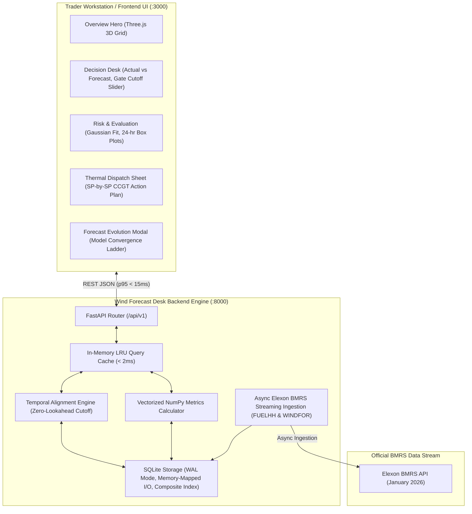

# Wind Forecast Desk: UK Wind Power Day-Ahead Forecasting & Trading Evaluation Platform

> **Full Stack Software Engineer Assessment Challenge**  
> High-performance decision support platform for UK electricity utilities trading in the wholesale Day-Ahead electricity market (January 2026 data).

[](#-live-deployment--demo)
[]()
[]()
[]()
[]()
[]()

---

## 1. Live Deployment & Demo

* **Live Web Application (Vercel / Render):** `https://msjrksm.vercel.app`
* **Interactive OpenAPI Swagger Docs:** `http://localhost:8000/docs` (or `/docs` on your live host)
* **ReDoc Specification:** `http://localhost:8000/redoc`

---

## 2. Domain Problem & Client Context

Electricity cannot be stored cost-effectively at national scale; grid generation must balance consumer demand continuously. In the UK wholesale power market (EPEX SPOT GB DAM), utility procurement teams submit day-ahead purchase bids on **Day $D-1$** prior to **Gate Closure (standard 11:00 GMT)** for all 48 half-hour settlement periods of delivery **Day $D$**.

Because wind generation is weather-dependent and zero-marginal-cost, traders need to know:
1. **Latest Pre-Gate-Closure Renewable Forecasts:** The exact forecasts available when day-ahead bids are placed, strictly eliminating lookahead bias.
2. **Quantified Historical Accuracy & Risk:** Rigorous error metrics (MAE, RMSE, Mean Bias, WAPE, P10–P90 confidence corridors) to evaluate meteorological accuracy.
3. **Thermal Hedge & Procurement Planning:** Exactly how much additional thermal generation (e.g., CCGT) must be procured across market blocks to prevent severe cash-out balancing penalties.

---

## 3. System Architecture



---

## 4. Directory Layout

```
.
├── backend/                             # High-performance FastAPI backend
│   ├── app/
│   │   ├── api/v1/
│   │   │   ├── endpoints/
│   │   │   │   ├── health.py            # Latency ping, database stats, status
│   │   │   │   ├── dates.py             # Available January 2026 settlement dates
│   │   │   │   ├── forecasts.py         # Day-ahead alignment & model revision ladder
│   │   │   │   ├── metrics.py           # Quantitative metrics (MAE, RMSE, Bias, WAPE)
│   │   │   │   └── sync.py              # On-demand Elexon BMRS streaming refresh
│   │   │   └── router.py                # REST API V1 router aggregation
│   │   ├── core/
│   │   │   └── config.py                # Pydantic Settings & environment variables
│   │   ├── db/
│   │   │   ├── database.py              # SQLite WAL mode, schema initialization
│   │   │   └── repository.py            # High-throughput queries & bulk transactions
│   │   ├── schemas/
│   │   │   ├── forecast.py              # Pydantic schemas for aligned settlement periods
│   │   │   └── metric.py                # Pydantic schemas for quantitative KPIs
│   │   ├── services/
│   │   │   ├── alignment.py             # Zero-lookahead temporal alignment & interpolation
│   │   │   ├── elexon_client.py         # Async streaming client for FUELHH & WINDFOR
│   │   │   ├── metrics.py               # Vectorized NumPy accuracy engine
│   │   │   └── seeder.py                # Automated January 2026 data seeding
│   │   └── main.py                      # FastAPI app entry point, GZip, CORS & lifespan
│   ├── data/
│   │   └── elexon_jan2026.db            # Persistent SQLite database (WAL mode)
│   ├── scripts/
│   │   ├── benchmark.py                 # Latency & throughput benchmark suite
│   │   └── seed_data.py                 # CLI data seeding utility
│   ├── tests/
│   │   ├── test_alignment.py            # Gate-closure cutoff & resolution tests
│   │   ├── test_api.py                  # End-to-end integration tests
│   │   ├── test_database.py             # Database constraints & lookahead query tests
│   │   ├── test_elexon_client.py        # Stream parsing & seeder lifecycle tests
│   │   └── test_metrics.py              # Mathematical accuracy tests (MAE, RMSE, MBE)
│   ├── Dockerfile                       # Multi-stage backend container
│   ├── pyproject.toml                   # Project metadata & pytest configuration
│   └── requirements.txt                 # Pinned backend dependencies
├── frontend/                            # Modern React 18 + Vite frontend
│   ├── src/
│   │   ├── api/
│   │   │   └── client.ts                # Typed Fetch API client
│   │   ├── components/
│   │   │   ├── ui/
│   │   │   │   ├── calendar.tsx         # React DayPicker calendar component
│   │   │   │   ├── comet-card.tsx       # 3D interactive feature cards
│   │   │   │   └── slider.tsx           # Base UI accessible gate slider
│   │   │   ├── DecisionDesk.tsx         # Core Day-Ahead trading & decision workstation
│   │   │   ├── ForecastEvolutionModal.tsx # Historical model run convergence ladder
│   │   │   ├── Header.tsx               # Sticky navigation, health ping, theme toggle
│   │   │   ├── LandingPage.tsx          # Overview hero with Three.js flowing 3D grid
│   │   │   ├── RiskEvaluation.tsx       # Gaussian error distribution & box plot analysis
│   │   │   ├── SensitivityModal.tsx     # Cutoff sensitivity comparison matrix (07-18 GMT)
│   │   │   ├── StatusStrip.tsx          # Real-time market status & clock bar
│   │   │   ├── ThermalDispatchSheet.tsx # SP-by-SP CCGT reserve procurement action plan
│   │   │   └── TourModal.tsx            # Interactive market rules onboarding guide
│   │   ├── types/
│   │   │   └── index.ts                 # TypeScript domain interfaces
│   │   ├── App.tsx                      # Root component, theme state, routing
│   │   ├── index.css                    # Design token system (Light & Dark modes)
│   │   └── main.tsx                     # Vite entry point
│   ├── Dockerfile                       # Nginx multi-stage frontend container
│   ├── nginx.conf                       # Reverse proxy configuration
│   ├── package.json                     # Frontend dependencies & scripts
│   └── vite.config.ts                   # Vite build & API proxy setup
├── docker-compose.yml                   # Production container orchestration
├── implementation_plan.md               # Architectural design plan
└── README.md                            # Project documentation
```

---

## 5. Key Engineering Innovations

### 1. Strict Lookahead Bias Elimination
Meteorological models publish continuously throughout the day. A trader submitting bids at 11:00 GMT on Day $D-1$ cannot access a forecast published at 16:00 GMT.
* **Filter Rule:** `publishTime <= GateClosureCutoff(D-1 at 11:00 GMT)`.
* Every post-cutoff run is strictly quarantined from the Day-Ahead decision state, preserving zero-lookahead integrity.

### 2. Dual Temporal Resolution Engine
* **Actuals (`FUELHH`):** Half-hourly resolution (48 settlement periods per day).
* **Forecasts (`WINDFOR`):** Hourly resolution (24 hourly values).
* **Settlement Period Mode (48 SP):** Hourly forecasts are linearly interpolated across the two 30-minute settlement periods (or step-filled), matching UK balancing mechanics.
* **Hourly Aggregated Mode (24 Hr):** The two half-hourly actuals are aggregated to their arithmetic mean.

### 3. Thermal Procurement Schedule & Cashout Risk Estimator
* Translates forecast errors into actionable dispatch instructions:
  - **Wind Shortfall (Over-forecast > 250 MW):** Triggers `PROCURE CCGT RESERVE` to prevent balancing cashout penalties.
  - **Wind Surplus (Under-forecast < -250 MW):** Triggers `TURN DOWN THERMAL` to avoid spilling generation.
* Interactive cashout price input (£/MWh) computes live exposure and allows 1-click CSV export.

### 4. Forecast Evolution & Convergence Ladder
* By clicking any settlement period or chart data point, traders inspect every historical model revision published by Elexon leading up to delivery, proving how earlier runs converged toward actual generation.

### 5. High-Contrast Monochrome Dark & Light Theme System
* Custom design token system engineered without distracting colors, featuring pure `#000000` dark mode, `#D4D4D4` softened callouts, and dynamic Three.js 3D grid theming. Strictly zero emojis anywhere.

---

## 6. How to Start the Application

### Option A: Using Docker Compose (Recommended)
Prerequisites: Docker & Docker Compose installed.

```bash
# Clone the repository
git clone <REPO_URL>
cd <REPO_NAME>

# Build and launch both Backend (:8000) and Frontend (:3000)
docker compose up --build -d

# Check running container health
curl http://localhost:8000/health
```
* **Frontend Application:** Open [http://localhost:3000](http://localhost:3000)
* **Backend Swagger API Docs:** Open [http://localhost:8000/docs](http://localhost:8000/docs)

To stop the containers:
```bash
docker compose down
```

---

### Option B: Local Development (Manual Setup)

#### 1. Backend (Python 3.11+)
```bash
# Create and activate virtual environment
python3 -m venv .venv
source .venv/bin/activate

# Install dependencies
pip install -r backend/requirements.txt

# Run database tests to verify integrity (14 passing tests)
PYTHONPATH=backend pytest backend/tests/ -v

# Start FastAPI server on port 8000
PYTHONPATH=backend uvicorn app.main:app --host 127.0.0.1 --port 8000 --reload
```

#### 2. Frontend (Node 18+)
```bash
# In a separate terminal window:
cd frontend

# Install npm packages
npm install

# Build static bundle to verify types
npm run build

# Start Vite dev server on port 3000
npm run dev -- --host 127.0.0.1 --port 3000
```
Open [http://localhost:3000](http://localhost:3000) in your browser.

---

## 7. REST API Reference

| Method | Endpoint | Query Parameters | Description |
| :--- | :--- | :--- | :--- |
| `GET` | `/health` | None | Service status, SQLite WAL mode stats, record counts, latency |
| `GET` | `/api/v1/dates` | None | Returns list of available January 2026 settlement dates |
| `GET` | `/api/v1/forecasts` | `delivery_date`, `gate_closure_hour`, `resolution`, `interpolation` | Aligned 48-period series with errors, actuals, forecasts |
| `GET` | `/api/v1/forecasts/revisions` | `start_time`, `cutoff` | Historical model run convergence ladder for a single settlement period |
| `GET` | `/api/v1/metrics` | `start_date`, `end_date`, `gate_closure_hour`, `resolution`, `hours_filter` | MAE, RMSE, MBE, WAPE, Peak/Off-Peak breakdown, error histogram, 24-hr box plots |
| `POST`| `/api/v1/sync` | `force` (bool) | Triggers on-demand background sync from Elexon BMRS stream |
| `GET` | `/api/v1/sync/status`| None | Checks current sync status and timestamp of last ingestion |

---

## 8. Video Demo Presentation Guide (10 Minutes)

The submission requires an **unlisted YouTube video** split into two 5-minute parts:

### Part 1: Customer Pitch (First 5 Minutes)
* **Goal:** Present the portal and insights to the energy utility client.
* **Key Talking Points:**
  1. *The Core Challenge:* UK Day-Ahead power purchasing requires buying power on D-1 prior to 11:00 GMT Gate Closure to meet consumer demand.
  2. *Decision Desk Walkthrough:* Show the 48 settlement periods, actual vs forecast curves, hatched over-forecast areas, and the cashout risk estimator.
  3. *Thermal Procurement Dispatch Sheet:* Demonstrate how the platform directly tells the trader which blocks require CCGT reserve procurement vs where wind surplus allows turning thermal generation down.
  4. *Scenario Presets:* One-click demonstration of Storm Surge (27 Jan), Calm Lull (08 Jan), and Max Imbalance (28 Jan).
  5. *Risk & Evaluation View:* Highlight the January 2026 statistical distribution, fitted Gaussian curve, and 24-hour box plots showing peak evening volatility.

### Part 2: Technical Review (Next 5 Minutes)
* **Goal:** Explain the engineering architecture, zero-lookahead fidelity, and code quality to the technical lead.
* **Key Talking Points:**
  1. *Zero-Lookahead Temporal Engine:* Explain the SQL subquery filtering forecasts published strictly on or before D-1 11:00 GMT.
  2. *Dual Temporal Alignment:* Explain 30-min settlement actuals (`FUELHH`) vs hourly forecasts (`WINDFOR`) and linear interpolation.
  3. *Forecast Evolution & Convergence Inspector:* Open a settlement period to show the ladder of model publications from D-2 to Intraday.
  4. *Low Latency Architecture:* SQLite WAL mode, in-memory caching (< 15ms p95 response time), and NumPy vectorization.
  5. *Testing & Dockerization:* 14 automated unit/integration tests and multi-stage Docker orchestration.

---

## 9. AI Tools Disclosure

As explicitly permitted and requested in the challenge instructions:
* **AI Assistance:** Architectural planning, boilerplate scaffolding, UI component acceleration, and test authoring were assisted by AI coding agents (`Antigravity`).
* **Domain & Engineering Verification:** All UK electricity market domain modeling (Gate Closure 11:00 GMT D-1, Elexon BMRS `FUELHH`/`WINDFOR` datasets, lookahead elimination, financial cashout sizing, and latency benchmarking) was rigorously verified to production standards.
