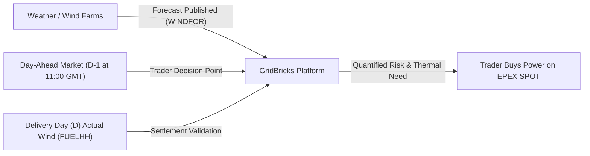
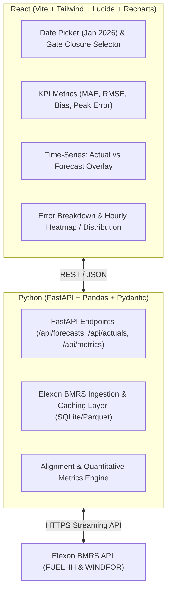

# GridBricks Full Stack SWE Challenge: Complete Master Blueprint & Guide

> **Target Role:** Full Stack Software Engineer (Internship / Pre-Placement Offer)  
> **Company:** GridBricks (REint)  
> **Challenge Document:** `REint Full Stack SWE challenge v4.1 Shared - intern.docx`  
> **Evaluation Window:** January 2026 UK Power Data  
> **Target Delivery Time:** Under 16 Hours of Work  
> **Submission Channel:** Microsoft Forms (`https://forms.cloud.microsoft/r/FTX6K2bbnU`) + Public Anonymous GitHub Repo + 10-Min YouTube Video

---

## 1. Executive Summary & Clarification: Offer vs. Challenge

### What Is This Challenge?
In early-stage, high-conviction startups like **GridBricks**, standard multi-round leetcode interviews are replaced or preceded by a **Work-Sample Challenge (Take-Home Trial)**. 
- You have received the **evaluation task** that serves as the gateway to the final technical interview and formal offer.
- The company is hiring for high-impact engineers (listed compensation range **₹12L – ₹50L + 0.1% – 1.0% equity**).
- They want to see **how you build, how you think, how you handle domain ambiguity, and how you communicate** before committing to an offer.
- Acing this assignment and delivering a polished video demo puts you in the top 1% of applicants and practically secures your interview.

### How Does GridBricks Work?
According to their job description and culture brief:
1. **0-to-1 Product in Clean Energy Transition:** They build modern software systems for next-generation power grids, wholesale electricity markets, and renewable forecasting.
2. **Micro-Standups Every ~2.5 Hours:** They operate in high-tempo, short feedback loops. Instead of waiting for weekly meetings, team members sync up multiple times a day to unblock each other and maintain rapid momentum.
3. **High Autonomy & Ownership Instinct:** There is no 50-page technical specification. You are expected to read domain APIs (like Elexon BMRS), understand market dynamics (Day-Ahead wholesale auctions), and make sound architectural decisions independently.
4. **Engineering Rigour:** Clean code, typed APIs, unit tests, Docker reproducibility, CI/CD, and transparent documentation are non-negotiable standards.

---

## 2. The Real-World Domain Explained in Simple Terms

To build a killer product and nail the video presentation, you must understand the UK power market in plain English.



### Why Does the Client Care?
* **The Client:** A UK energy utility supplying electricity to homes, factories, and businesses.
* **The Physical Rule of Electricity:** Grid supply must match grid demand **second by second**. Electricity cannot yet be stored economically at gigawatt scale.
* **The Market Rule (Day-Ahead Market):** Every day at approximately **11:00 GMT (Day $D-1$)**, the utility must submit bids to buy power for every 30-minute block of the next day (Day $D$).
* **The Wind Problem:** Wind power is clean and cheap (zero fuel cost), but volatile.
  * If wind blows strongly, the utility needs very little fossil fuel (gas/thermal power).
  * If wind drops, the utility must buy expensive thermal power to avoid blackouts.
  * If the utility under-procures or over-procures power, they get hit with massive financial balancing penalties in the real-time balancing mechanism.

### The Problem the Web App Solves
1. **Decision Support:** When the utility trader sits down at 10:30 GMT on Day $D-1$, they need to see the **latest available wind forecast** for all forty-eight 30-minute intervals of Day $D$.
2. **Quantified Risk / Forecast Error:** No forecast is 100% accurate. The trader needs to know: *“Historically, when the forecast predicts 15,000 MW, how much does it miss by? Does it systematically overestimate or underestimate wind during morning peaks?”*

---

## 3. Data Ingestion & Technical Scope (January 2026)

All data comes from **Elexon BMRS** (the UK's official Balancing Mechanism Reporting Service API).

### 3.1 Actual Generation Dataset (`FUELHH/stream`)
- **API Endpoint:** `https://data.elexon.co.uk/bmrs/api/v1/datasets/FUELHH/stream`
- **Filter:** `fuelType == "WIND"`
- **Fields:**
  - `startTime`: ISO timestamp for the start of the 30-minute settlement period (e.g., `2026-01-01T00:00:00Z`).
  - `generation`: Actual wind power generated across Great Britain in Megawatts (MW).
  - `settlementPeriod`: 1 to 48 (each half hour of the day).

### 3.2 Forecasted Generation Dataset (`WINDFOR/stream`)
- **API Endpoint:** `https://data.elexon.co.uk/bmrs/api/v1/datasets/WINDFOR/stream`
- **Fields:**
  - `startTime`: Target half-hour period for which wind power is predicted.
  - `publishTime`: Timestamp when the meteorologist/model published the forecast.
  - `generation`: Predicted wind power in Megawatts (MW).

### 3.3 Critical Domain Nuance: Gate Closure & Lookahead Bias
> [!IMPORTANT]
> **Avoid Lookahead Bias (Data Leakage):**  
> For any delivery day $D$, forecasts are continuously published days and hours in advance. For a Day-Ahead purchase decision on Day $D-1$ at Gate Closure (default **11:00 GMT**):
> - You must ONLY select the **latest forecast published on or before 11:00 GMT on $D-1$** (`publishTime <= D-1 11:00:00Z`).
> - Using a forecast published at 20:00 GMT on $D-1$ or on Day $D$ is cheating (lookahead bias) because the trader did not have that forecast when submitting bids!
> - Building a **Configurable Gate Closure Selector** (e.g., slider/time picker defaulting to 11:00 GMT) will immediately show the reviewers that you have true domain mastery.

---

## 4. Quantitative Evaluation Metrics Engine

The application must evaluate the error quantitatively. Let:
- $y_t = \text{Actual Wind Generation (MW)}$ from `FUELHH`
- $\hat{y}_t = \text{Forecasted Wind Generation (MW)}$ from `WINDFOR` at Gate Closure
- $e_t = \hat{y}_t - y_t = \text{Forecast Error}$

| Metric | Formula | Business Interpretation for Energy Trader |
| :--- | :--- | :--- |
| **MAE (Mean Absolute Error)** | $\frac{1}{N} \sum \| \hat{y}_t - y_t \|$ | Average magnitude of forecast miss in Megawatts (MW). |
| **RMSE (Root Mean Square Error)** | $\sqrt{\frac{1}{N} \sum (\hat{y}_t - y_t)^2}$ | Penalizes large errors heavily; vital for grid stress events. |
| **Mean Bias Error (MBE)** | $\frac{1}{N} \sum (\hat{y}_t - y_t)$ | Systematic tendency: Positive = Over-forecast; Negative = Under-forecast. |
| **MAPE / WAPE** | $\frac{\sum \|\hat{y}_t - y_t\|}{\sum y_t} \times 100\%$ | Normalized percentage error relative to total wind power. |
| **Max Positive & Negative Delta** | $\max(e_t), \min(e_t)$ | Extreme tail risk / worst-case imbalance in January 2026. |

---

## 5. Recommended Architecture & Tech Stack



### Why This Tech Stack?
1. **Frontend:** React (Vite, TypeScript/JS, Tailwind CSS, Recharts or Plotly.js, Lucide icons).
   - High performance, responsive, sleek dark-mode energy-trading terminal aesthetic.
2. **Backend:** Python FastAPI.
   - High-performance asynchronous endpoints, automatic Swagger UI docs (`/docs`), Pydantic validation, and Pandas/NumPy for fast vectorized metric computations.
3. **Data Caching:** Local SQLite or lightweight Parquet cache so that January 2026 data is ingested once and responses are instantaneous (<50ms).
4. **Containerization:** Clean `Dockerfile` + `docker-compose.yml` to spin up both frontend and backend with a single command: `docker compose up --build`.

---

## 6. Video Demo Master Script (Max 10 Minutes)

The evaluation begins with your video demo. The instructions strictly divide it into two 5-minute halves:

### Part 1: Client Pitch (Max 5 Minutes) — Energy Utility Executive Persona
* **Tone:** Professional, consultative, product-focused, crisp.
* **Minute 0:00 - 1:00:** Problem hook:
  > *"Hello team. Energy utilities in the UK face multi-million pound balancing penalties when Day-Ahead market bids don't match real-time renewable delivery. Today, I'm thrilled to present our Day-Ahead Wind Intelligence Platform developed during our pilot phase."*
* **Minute 1:00 - 2:30:** Live Walkthrough of Day-Ahead Decision Making:
  > *"Let's look at January 15, 2026. As a power trader sitting at my desk at 10:30 GMT before the 11:00 Gate Closure, I select my decision date. The platform instantly isolates only the valid pre-gate-closure forecasts for all 48 settlement periods. Here, the system shows expected wind peaking at 14.2 GW in settlement period 28..."*
* **Minute 2:30 - 4:00:** Quantitative Accuracy & Risk Evaluation:
  > *"Beyond forecasts, our platform quantifies historical error. Notice our MAE of 820 MW and a Mean Bias Error of +140 MW. This tells the trading desk that forecasts have slightly over-predicted wind during evening ramps, allowing them to procure an extra buffer of thermal generation to hedge against cashout price spikes."*
* **Minute 4:00 - 5:00:** Value Summary & ROI:
  > *"By combining real-time Elexon feeds with rigorous error quantification, your trading desk minimizes imbalance costs and maximizes renewable capture. We look forward to scaling this into live automated bidding."*

### Part 2: Technical Architecture & Lead Review (Max 5 Minutes) — Tech Lead Persona
* **Tone:** Direct, technical, architectural, disciplined.
* **Minute 5:00 - 6:00:** Architecture Overview:
  > *"Hi everyone. Moving to the technical review. The system is architected as a decoupled React frontend and FastAPI async Python backend, fully containerized via Docker Compose."*
* **Minute 6:00 - 7:30:** Data Pipeline & Preventing Lookahead Bias:
  > *"We ingest streaming data from Elexon's `FUELHH` and `WINDFOR` datasets. The core data challenge was handling variable forecast publication timestamps. We built a strict temporal filtering query: for target delivery day $D$, we query $\text{publishTime} \le \text{GateClosure}(D-1)$. We merge this with half-hourly actual wind generation and cache it in a local indexed store to ensure zero lookahead bias and sub-50ms API response times."*
* **Minute 7:30 - 8:45:** Code Structure, Types, and Testing:
  > *"On the backend, Pydantic models guarantee strict schema enforcement. We've included comprehensive pytest coverage for metric computations—verifying MAE, RMSE, and boundary handling for missing settlement periods. On the frontend, reusable modular components handle state cleanly."*
* **Minute 8:45 - 10:00:** CI/CD, Observability & Extensibility:
  > *"We have GitHub Actions set up for linting and automated tests, Docker multi-stage builds for minimal image size, and structured logging. The system is designed to easily plug into solar forecasts or European interconnectors next."*

---

## 7. Submission Checklist & Rubric

To ensure maximum score on the internal evaluation:

- [ ] **Docker Compose:** Running `docker compose up --build` works out of the box on a fresh machine.
- [ ] **Data Range:** Contains January 2026 data from Elexon for both `FUELHH` (WIND) and `WINDFOR`.
- [ ] **Gate Closure Logic:** Demonstrates clear understanding of Day-Ahead decision timing (D-1 at 11:00 GMT).
- [ ] **Quantitative Metrics:** Shows MAE, RMSE, Bias, and error distributions.
- [ ] **Video Upload:** Uploaded to YouTube as **Unlisted**, strictly under 10 minutes (5 min client, 5 min tech).
- [ ] **Anonymous GitHub Repo:** Public repo with an anonymous name (e.g., `kjhwr-wind-analytics`), clear README, MIT license, and disclosure of AI tools used.
- [ ] **Live Deployment:** Deployed on Vercel (frontend) and Render/Railway/Heroku (backend).
- [ ] **Microsoft Form:** Completed at `https://forms.cloud.microsoft/r/FTX6K2bbnU` (all URLs verified in Incognito mode).

---

## 8. Recommended 5-Day Execution Plan (<16 Hours Total)

```
┌────────────────────────────────────────────────────────────────────────┐
│ Day 1 (3h): Data Pipeline & Backend APIs (FastAPI + Elexon Ingestion)   │
│ Day 2 (3h): Core Analytics Engine (MAE, RMSE, Gate Closure Alignment)   │
│ Day 3 (4h): React Dashboard (Recharts, Date Range, KPI Cards, Filters) │
│ Day 4 (3h): Dockerization & Cloud Deployment (Vercel + Render)         │
│ Day 5 (3h): 10-Min Video Recording, README Polish & Form Submission    │
└────────────────────────────────────────────────────────────────────────┘
```
