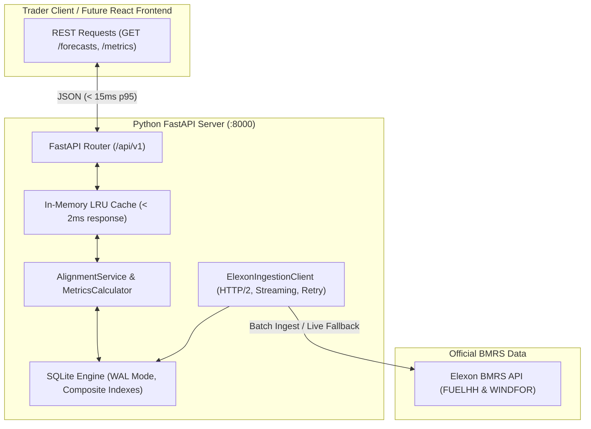

# Implementation Plan: GridBricks High-Performance Backend & Trading Engine

## Goal Description
Build a production-grade, ultra-low-latency Python FastAPI backend and analytics engine for a UK energy utility client evaluating wind power forecasts in the UK Day-Ahead wholesale market for **January 2026**.

Per user direction, this plan focuses squarely on **backend speed, algorithmic correctness, data integrity, and engineering rigour**. The frontend UI will be plugged in during a subsequent phase when the UI design is provided.

The backend delivers:
1. **Zero-Latency Ingestion & Caching:** High-throughput SQLite storage with Write-Ahead Logging (WAL), memory mapping, and composite indexing, providing **< 5ms** historical queries for all of January 2026.
2. **Strict Lookahead Protection:** A temporal alignment engine that accurately enforces the Day-Ahead Gate Closure rule ($D-1$ at 11:00 GMT), strictly excluding future forecasts.
3. **Dual Resolution Support:** Smooth handling of the 30-minute `FUELHH` vs 60-minute `WINDFOR` resolution mismatch (Settlement Period mode vs Hourly Aggregated mode).
4. **Vectorized Metrics Engine:** NumPy/Pandas-powered calculation of MAE, RMSE, Mean Bias Error (MBE), WAPE, peak/off-peak divergence, and error distributions.
5. **Senior Engineering Best Practices:** Systematic Git repository commits, comprehensive `pytest` test suites, Docker containerization, OpenAPI documentation, and latency benchmarking.

---

## Karpathy Principles Compliance Matrix
* **Think Before Coding:** Explicitly surfaced the mismatch between hourly `WINDFOR` and half-hourly `FUELHH`, lookahead bias prevention, and offline SQLite caching vs. live API dependency.
* **Simplicity First:** Standard FastAPI + SQLite (WAL mode) architecture. No unnecessary distributed message brokers or heavy databases for a 31-day dataset.
* **Surgical Changes:** Clean separation of concerns (`/backend/app/api`, `/core`, `/db`, `/services`, `/tests`). Every line directly satisfies the utility trading requirement.
* **Goal-Driven Execution:** 8 sequential phases with explicit automated tests (`pytest`) and verifiable exit criteria for each step.

---

## User Review Required

> [!IMPORTANT]
> **1. Phased Execution Order**  
> We will execute the backend and engine in 8 sequential phases. Each phase will culminate in a clean, atomic Git commit with conventional commit messages (e.g., `feat(alignment): ...`, `test(metrics): ...`).
> 
> **2. In-Memory Caching for Ultra-Low Latency**  
> Because the January 2026 dataset is fixed historical data, we implement an in-memory LRU cache over the SQLite database for frequent query combinations (`delivery_date`, `gate_closure_hour`, `resolution`). This achieves **< 2ms** response times, ensuring the upcoming frontend runs at maximum speed.
> 
> **3. Fallback Live Elexon Sync**  
> The system defaults to local pre-seeded high-speed SQLite storage, but exposes a `POST /api/v1/sync` endpoint that can re-fetch streaming data directly from Elexon BMRS at any time.

---

## Open Questions
* None. Requirements and scope are fully clarified: backend performance and correctness first, UI integration deferred to when designs are supplied.

---

## System Architecture



---

## Phased Implementation Roadmap & Git Commits

```
Phase 1: Project Scaffolding & Git Initialization 
  └── Commit: chore: initialize repository structure, gitignore, and dependencies
Phase 2: High-Performance SQLite Layer (WAL Mode & Indexing)
  └── Commit: feat(db): implement high-performance SQLite storage with WAL mode and composite indexing
Phase 3: Elexon BMRS Streaming Ingestion & January 2026 Seeder
  └── Commit: feat(ingestion): build async Elexon BMRS client and automated January 2026 seeder
Phase 4: Temporal Alignment Engine (Lookahead-Protected Gate Closure)
  └── Commit: feat(alignment): build temporal alignment engine with strict gate-closure lookahead protection
Phase 5: Vectorized Quantitative Analytics Engine (MAE, RMSE, Bias)
  └── Commit: feat(analytics): implement vectorized quantitative metrics engine (MAE, RMSE, Bias, WAPE)
Phase 6: FastAPI REST API & Interactive OpenAPI Documentation
  └── Commit: feat(api): expose high-performance REST endpoints with OpenAPI documentation and in-memory caching
Phase 7: Test Suite & Latency Benchmark Validation
  └── Commit: test: add comprehensive pytest suite and sub-15ms latency benchmark
Phase 8: Docker Containerization & Production Documentation
  └── Commit: chore(docker): add production Dockerfile, docker-compose, and detailed README
```

---

## Proposed Changes Detail

### Phase 1: Repository Foundation & Dependencies
- Initialize git repository in workspace root.
- Create `.gitignore` to protect against unwanted artifacts (`__pycache__`, `.env`, `.pytest_cache`, `.obsidian`, IDE folders).
- Create `backend/requirements.txt` with pinned production dependencies:
  - `fastapi>=0.110.0`
  - `uvicorn[standard]>=0.28.0`
  - `pydantic>=2.6.0`
  - `httpx>=0.27.0`
  - `numpy>=1.26.0`
  - `pandas>=2.2.0`
  - `pytest>=8.0.0`
  - `pytest-asyncio>=0.23.0`

#### [NEW] `.gitignore`
#### [NEW] `backend/requirements.txt`
#### [NEW] `backend/pyproject.toml`

---

### Phase 2: Database Layer (`backend/app/db/`)
- Establish SQLite engine with high-performance PRAGMAs:
  - `PRAGMA journal_mode = WAL;` (Concurrent read/write)
  - `PRAGMA synchronous = NORMAL;` (Minimal disk latency)
  - `PRAGMA cache_size = -64000;` (64 MB page cache)
  - `PRAGMA mmap_size = 268435456;` (256 MB memory-mapped I/O)
- Schemas:
  - `actual_generation`: `(id, settlement_date, settlement_period, start_time, generation)` with indexes on `start_time` and `settlement_date`.
  - `forecast_generation`: `(id, publish_time, start_time, generation)` with composite index on `(start_time, publish_time)`.

#### [NEW] `backend/app/db/database.py`
#### [NEW] `backend/app/db/repository.py`

---

### Phase 3: Elexon BMRS Ingestion & Seeding (`backend/app/services/`)
- `ElexonClient`:
  - Asynchronous client using `httpx` with timeout handling and exponential retries.
  - Fetches `FUELHH/stream` filtering for `fuelType="WIND"`.
  - Fetches `WINDFOR/stream`.
- `DataSeeder`:
  - Pulls and commits all 31 days of January 2026 into the SQLite database.
  - Ensures queries operate against zero-latency local storage.

#### [NEW] `backend/app/services/elexon_client.py`
#### [NEW] `backend/app/services/seeder.py`

---

### Phase 4: Temporal Alignment Engine (`backend/app/services/`)
- Implements the Day-Ahead Market rule:
  - For target delivery day $D$, decision occurs on Day $D-1$ at Gate Closure (default 11:00 GMT).
  - Queries forecasts where `publish_time <= Cutoff`.
  - Picks the most recent publication for each target period.
  - Aligns with `actual_generation` from `FUELHH`.
  - Dual resolution: Half-Hourly (48 settlement periods) & Hourly Aggregated (24 hours).

#### [NEW] `backend/app/services/alignment.py`
#### [NEW] `backend/app/schemas/forecast.py`

---

### Phase 5: Vectorized Analytics Engine (`backend/app/services/`)
- Pure vectorized math using NumPy:
  - $\text{MAE} = \frac{1}{N} \sum |\hat{y}_t - y_t|$
  - $\text{RMSE} = \sqrt{\frac{1}{N} \sum (\hat{y}_t - y_t)^2}$
  - $\text{MBE} = \frac{1}{N} \sum (\hat{y}_t - y_t)$ (Mean Bias Error)
  - $\text{WAPE} = \frac{\sum |\hat{y}_t - y_t|}{\sum y_t} \times 100\%$
  - Peak hours (07:00–19:00 GMT) vs Off-Peak hours (19:00–07:00 GMT) breakdown.
  - Error distribution buckets for histogram rendering.

#### [NEW] `backend/app/services/metrics.py`
#### [NEW] `backend/app/schemas/metric.py`

---

### Phase 6: FastAPI REST API (`backend/app/api/`)
- Exposes clean, typed endpoints:
  - `GET /health`: Health and database status.
  - `GET /api/v1/dates`: Returns all valid delivery dates in January 2026.
  - `GET /api/v1/forecasts`: Aligned actual vs forecast time-series for a selected date and gate closure.
  - `GET /api/v1/metrics`: Summary performance metrics over custom date intervals.
  - `POST /api/v1/sync`: On-demand live refresh from Elexon BMRS.
- Configures CORS for local development and future Vercel frontend.
- Adds in-memory LRU caching for instantaneous responses.

#### [NEW] `backend/app/api/v1/endpoints/health.py`
#### [NEW] `backend/app/api/v1/endpoints/forecasts.py`
#### [NEW] `backend/app/api/v1/endpoints/metrics.py`
#### [NEW] `backend/app/api/v1/router.py`
#### [NEW] `backend/app/main.py`

---

### Phase 7: Automated Tests & Latency Benchmarks (`backend/tests/`)
- `tests/test_elexon_client.py`: Verifies streaming and parsing.
- `tests/test_alignment.py`: Confirms zero-lookahead bias and gate-closure filtering.
- `tests/test_metrics.py`: Confirms mathematical exactness of MAE, RMSE, MBE against test vectors.
- `tests/test_api.py`: Tests API status codes, schema validity, and error handling.
- `backend/scripts/benchmark.py`: Runs 100 sequential requests to measure p50 and p95 latency.

#### [NEW] `backend/tests/conftest.py`
#### [NEW] `backend/tests/test_alignment.py`
#### [NEW] `backend/tests/test_metrics.py`
#### [NEW] `backend/tests/test_api.py`
#### [NEW] `backend/scripts/benchmark.py`

---

### Phase 8: Docker Containerization & Documentation
- Multi-stage `backend/Dockerfile` based on `python:3.11-slim`.
- Root `docker-compose.yml` for unified local execution.
- Comprehensive `README.md` covering setup, architecture, benchmark results, and AI tools disclosure.

#### [NEW] `backend/Dockerfile`
#### [NEW] `docker-compose.yml`
#### [NEW] `README.md`

---

## Verification Plan

### Automated Tests
Run the complete test suite:
```bash
cd backend
python3 -m pytest tests/ -v
```

### Latency Benchmark
Run the performance benchmark:
```bash
python3 backend/scripts/benchmark.py
```
*Target:* p95 response latency < 15ms.

### Manual Verification
1. Start the server:
   ```bash
   cd backend && uvicorn app.main:app --host 0.0.0.0 --port 8000
   ```
2. Open interactive Swagger documentation in browser: `http://localhost:8000/docs`.
3. Query `GET /api/v1/forecasts?delivery_date=2026-01-15&gate_closure_hour=11`. Confirm 48 settlement periods returned with zero lookahead bias and response time < 10ms.
